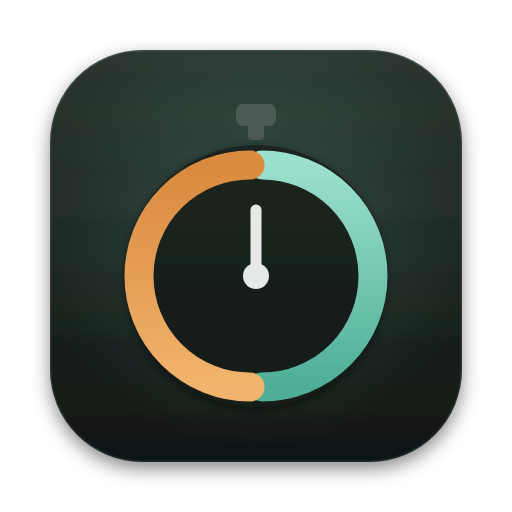

# ONE · CountdownOverlay



The product page is [`docs/index.html`](docs/index.html).

Menubar app that runs the Opened / Closed session timer described in `Specification.md`:
a session alternates between **Opened** (screen free) and **Closed** (every connected screen
covered by a dark overlay), each 4, 8 or 16 minutes long. Every mode change goes through a
confirmation box on the blocked screen, reminders announce the time left at halving intervals,
and the only way out of Closed early is a small prime-arithmetic puzzle that buys a 20-minute
pause. A system sound marks every transition point.

In Closed, what covers the main screen is a canvas you write on (`Canvas.html`), under a strip
with the time left, the reminders and **I need out**. The rest of the time it's one click away: the
second menu-bar icon (the pencil) opens it in an ordinary window you can close.

The app is one Swift file, `main.swift`, plus that page and its icon (`assets/AppIcon.icns`, drawn
from `assets/icon.svg`), which the build copies into the bundle.

## Install

Paste this in Terminal (macOS 11 or newer):

```sh
curl -fsSL https://raw.githubusercontent.com/ainigh/ONE/main/install.sh | bash
```

It downloads the latest release into `~/Applications/CountdownOverlay.app` and opens it. If
there's no release yet (GitHub Actions hasn't built one), it builds from the source instead,
which needs Apple's command line tools (`xcode-select --install`). If the new copy quits as soon
as it opens, the installer puts the one you had back. Running the line again is always safe.

To install a branch that isn't merged yet, and follow that branch for updates:

```sh
curl -fsSL "https://raw.githubusercontent.com/ainigh/ONE/BRANCH/install.sh" | BRANCH=BRANCH bash
```

## Updates

The app follows `main` (or the branch it was installed from). It checks at launch, every 6
hours, and when you choose **Check for Updates…** in the right-click menu, which always shows the
version and commit you're on. When the branch has a commit this copy wasn't built from, the menu
offers:

- **Update to v1.0.N**: GitHub already built that commit. The app downloads it, swaps itself and
  reopens.
- **Update (build here)**: GitHub hasn't built it yet. The app downloads that commit's source,
  builds it on this Mac, swaps itself and reopens. Build output goes to
  `~/Library/Logs/CountdownOverlay/update.log`.

Updating is offered only between sessions, since it restarts the app. If an update fails,
**Copy Update Details** copies the error and the end of the log.

GitHub Actions (`.github/workflows/build.yml`) builds every push and publishes a release
(`v1.0.<run number>`, with `CountdownOverlay.zip`) for every push to `main`.

The app is ad-hoc signed with a requirement of just its bundle identifier
(`com.ainigh.CountdownOverlay`), so macOS treats every update as the same app. To sign with your
own certificate instead, run
`defaults write com.ainigh.CountdownOverlay signIdentity "THE CERTIFICATE NAME"` once; updates
built on your Mac are then signed with it.

## Build it yourself (no Xcode project needed)

```sh
make app      # builds build/CountdownOverlay.app (and build/CountdownOverlay.zip)
make install  # copies it into ~/Applications and opens it
make run      # builds and opens it from build/
```

Or just the bare binary, which still works but doesn't check for updates:

```sh
swiftc -O -o CountdownOverlay main.swift -framework Cocoa -framework AVFoundation -framework ServiceManagement -framework WebKit
./CountdownOverlay      # run from the checkout, so it finds Canvas.html
```

Requires Xcode command line tools (`xcode-select --install`), macOS 11+.

## Use

- Click the menubar icon (a ring) → **Start Session** → pick 10 minutes, or 1, 2, 4 or 8 hours.
  The first confirmation (*Ready to start?*) appears at once; choose the slot (4 / 8 / 16 minutes)
  and press **Start** (Return works too; ← → or 4, 8, 6 pick the slot). It says when the mode will
  end and how long the session has left, or that this is the last round. 10 minutes is for trying
  the flow: pick 4 at each confirmation to see Opened, Closed and Opened again before the session
  ends.
- **The menu bar** shows the time left beside a ring whose pie empties as the mode runs out. The
  menu opens on a live header (the mode, the time, a progress bar, when the session ends and how
  many Closed rounds are done) and holds **Open Canvas**, **Sound** (on or off, four loudness
  levels, a sample) and **Open at Login**.
- **Reminders** pop up in the middle of every screen, above everything (the blocked screen
  included), with the time left: `08:00 left in Opened`. They never take the keyboard, go away
  after a few seconds, and a click dismisses them sooner. Opened starting, a pause and the end of
  the session pop up the same way.
- **Opened**: the screen is free and the menubar shows `mm:ss` left.
- **Closed**: the main screen shows the canvas; the strip above it, and every other screen, show
  `mm:ss` left and the reminders. **I need out** opens the puzzle:
  a correct answer pauses everything for 20 minutes, three wrong ones disable the button for
  2 minutes (the field shakes and three dots count the tries; Esc is **Never mind**). One
  successful escape per hour; the button is hidden on cooldown, and the screen says when it's
  back.
- **The canvas** is an infinite surface for notes. Double-click anywhere (or **+ Surface**, or
  N) to start a surface and write straight on it. Drag a surface by its edge or the dotted strip
  on its right (⌥ copies it, ⇧ keeps it straight), resize it from the bottom-right corner
  (double-click the corner to fit the text), and open the dot in the strip for its colour (12),
  text size (4), Duplicate, Fit to text and Delete. ⌘Z / ⇧⌘Z undo and redo everything. Drag empty
  space, scroll or hold Space to move around; pinch or ⌘-scroll to zoom; ⌘0 shows everything, and
  when every surface is out of view a prompt brings you back. **?** lists the shortcuts. It's
  kept in `~/Library/Application Support/CountdownOverlay/canvas.json` (the previous good copy
  is `canvas.previous.json`; a file that can't be read is set aside, never overwritten) and comes
  back every Closed and every time you open it. The font is embedded, so it never needs the
  network. (Maps from the old mind map stay in `mindmaps.json`; nothing reads them now.)
- The session ends at the first confirmation after the chosen length, with a pop-up that tallies
  the Closed rounds. Quit and updates are disabled during a session; if the app is killed or the
  Mac restarts, it reopens to a confirmation for the interrupted mode. That needs it to open at
  login, so an installed copy turns **Open at Login** on the first time it runs (macOS 13+;
  turn it off in the menu).
- Sounds at each transition are listed in `Specification.md` §9. They play 18 dB louder than
  macOS plays them (through a limiter, so they don't distort); the system volume still sets the
  ceiling. Pick the loudness in **Sound**, or set any boost with
  `defaults write com.ainigh.CountdownOverlay soundBoost 24` (0 to 24 dB). Launch with
  `-mute YES` to silence them, or `-minute 2` to make an app minute 2 seconds long and try the
  whole cycle quickly. `-h` / `--help` prints usage, `--version` the version and commit.
  `-preview DIR` draws the blocked screens, a pop-up, the menu header and the menu-bar icons into
  PNGs and quits; CI does it on every build and keeps them as the `previews` artifact.

  ```sh
  ./CountdownOverlay -minute 2
  ./CountdownOverlay -mute YES
  ```

## Robustness notes

- Every countdown is derived from a deadline, not a once-per-second tick, so it
  never drifts and resolves correctly if the Mac sleeps mid-mode.
- While the screen is blocked, key events only reach the overlay windows, which
  pass Return to their buttons and typing to the puzzle's answer field or the canvas, and swallow
  everything else; the app re-activates itself if it loses focus, so Cmd-Q / Esc
  can't slip through via another window.
- Overlays are rebuilt (coalesced, after a short delay) when displays are
  added, removed or resized, and placed in global coordinates so secondary
  displays are covered correctly.
- The digits scale with the smallest screen dimension.
- Focus returns to the app that was frontmost before the screen was blocked.
- Session end, the interrupted mode, the slots, the Closed tally and the escape cooldown are
  kept in user defaults, so a relaunch lands on the right confirmation. A session whose time ran
  out while the app wasn't running ends quietly at the next launch.
- Sounds play through their own audio engine, which lets go of the hardware when quiet and
  starts afresh after headphones or speakers change; without an output device it falls back to
  NSSound.
- Return on an empty answer field isn't counted as a wrong answer.
- The blocked screen blurs whatever is behind it under a deep shade, so it's unreadable but
  not jarring, and fades in over a quarter of a second.

## What can't be blocked

Cmd-Option-Esc (Force Quit), Mission Control gestures and the power button are
reserved by macOS. The puzzle is friction, not security (Specification §6); the app simply
makes casual dismissal (Esc, click, Cmd-Q) impossible.
